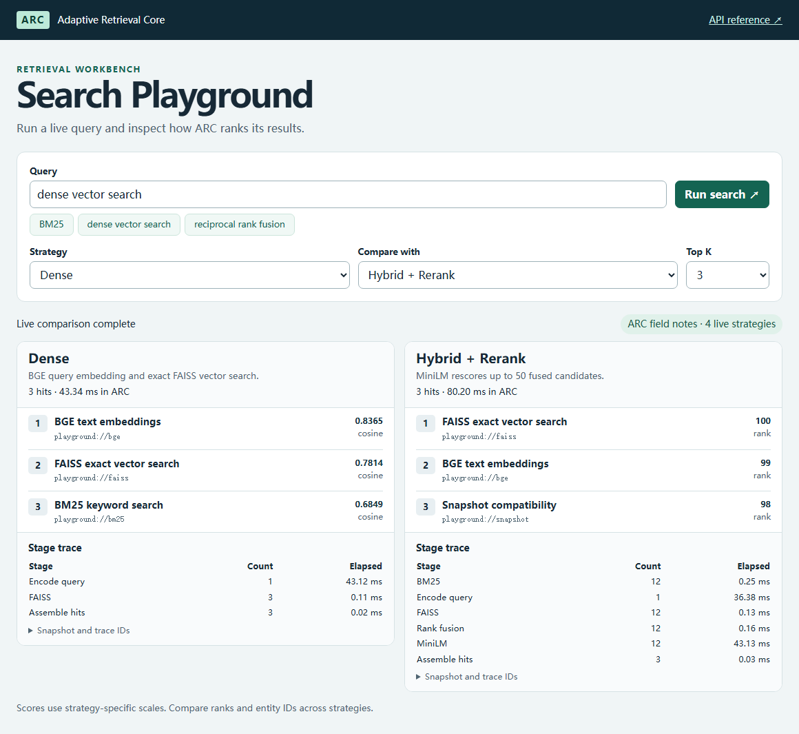
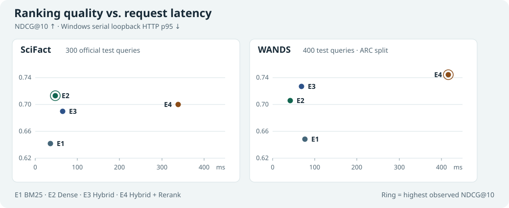
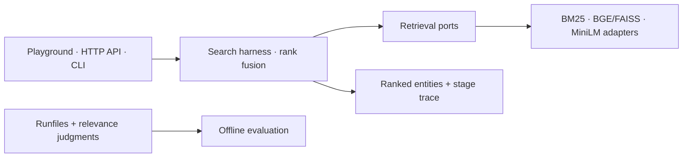

# Adaptive Retrieval Core

**Run and compare four search strategies behind one retrieval API.** ARC makes it easy to see how keyword search, embeddings, rank fusion, and reranking change the same query’s results and cost.

[v0.1.0 release](https://github.com/re-tourist/adaptive-retrieval-core/releases/tag/v0.1.0) · [CI](https://github.com/re-tourist/adaptive-retrieval-core/actions/workflows/cpu.yml) · [Quickstart](docs/QUICKSTART.md) · [中文](README.zh-CN.md)

## Search Playground



*A live Dense vs. Hybrid + Rerank comparison on ARC’s original field notes, with local models and a matching index. The quickstart runs [CPU BM25](docs/assets/playground-cpu.png). Load your local SciFact or WANDS snapshot for a full-corpus comparison.*

## What ARC exposes

- **One search contract.** Use the same retrieval harness from Python, the CLI, FastAPI, or the Playground. Results carry source IDs, ranks, and strategy-specific scores.
- **Four strategies.** Start with BM25 or BGE embeddings and exact FAISS search. Fuse ranks with RRF, then optionally rerank the first 50 candidates with MiniLM.
- **Inspectable runs.** Pin a snapshot, filter by entity ID, and trace stage timings and item counts. Offline relevance judgments stay outside live search.

## V0 benchmark



| Strategy | SciFact NDCG@10 | WANDS NDCG@10 |
| --- | ---: | ---: |
| E1 · BM25 | 0.641400 | 0.648530 |
| E2 · Dense | **0.712707** | 0.705657 |
| E3 · Hybrid | 0.689995 | 0.726482 |
| E4 · Hybrid + Rerank | 0.700141 | **0.744195** |

Dense led SciFact on NDCG@10. On WANDS, MiniLM improved Hybrid from 0.726482 to 0.744195 while local HTTP p95 rose from 68.89 to 416.11 ms. Across both test sets, E3 and E4 shared each query’s Top-100 candidate set.

SciFact uses 300 official test queries. WANDS uses ARC’s custom 80/400 split and incomplete relevance judgments. Latencies are serial loopback HTTP measurements on Windows 11 with an RTX 4060 Laptop GPU. The [full acceptance report](docs/ARC-V0-ACCEPTANCE.md) includes measured conditions, paired intervals, recall, and judged coverage.

## Quickstart

With Docker, run from the repository root:

```sh
docker build --tag arc:v0 .
docker run --rm -e ARC_DATASET=playground -p 127.0.0.1:8000:8000 arc:v0
```

Open [http://127.0.0.1:8000/playground/](http://127.0.0.1:8000/playground/) and try **reciprocal rank fusion**. The container uses CPU BM25 over 12 original field notes. The [uv, CLI, API, and full-strategy guide](docs/QUICKSTART.md) covers Python 3.12 and loading local snapshots.

## Architecture



- [Engineering](docs/ENGINEERING.md) explains score semantics, snapshot compatibility, and the online/offline boundary.
- [Reproduce V0](docs/REPRODUCING.md) covers the official datasets, pinned models, and experiment commands.
- [Documentation index](docs/INDEX.md) links frozen specifications, decisions, and milestone evidence.

V0 is scoped to local evaluation and demos. Production access control, tenant isolation, and concurrent capacity are outside its acceptance scope.
