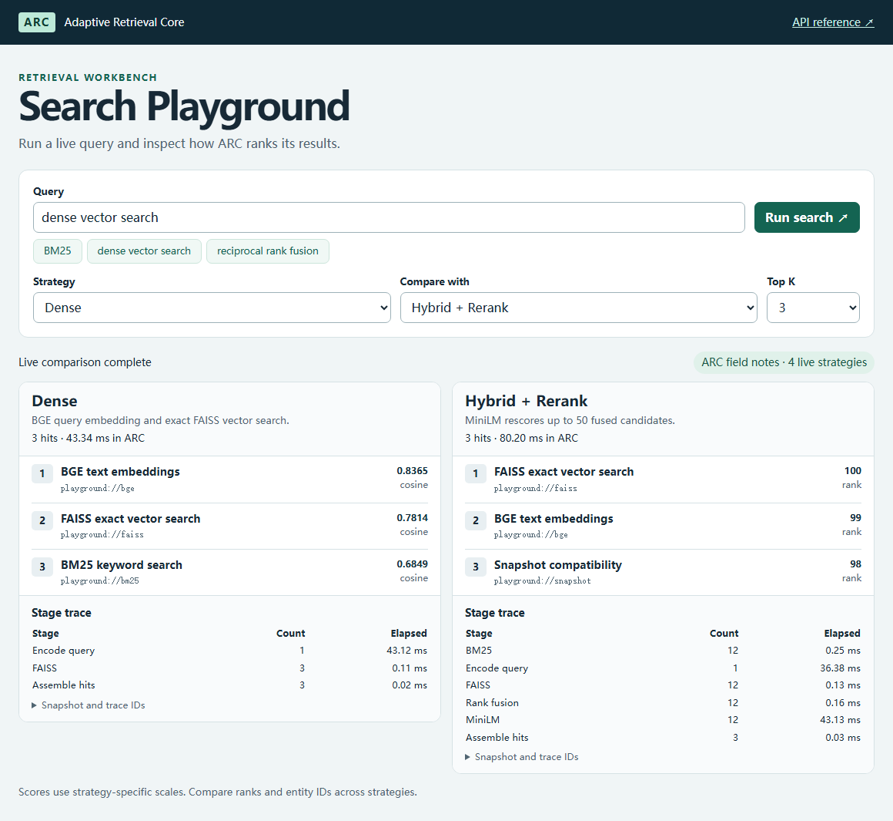
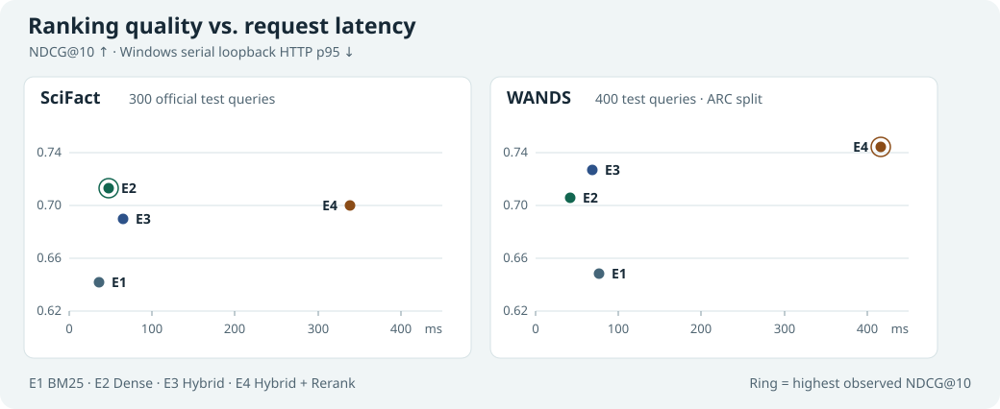

# Adaptive Retrieval Core

**用同一个检索 API 运行和比较四种搜索策略。** ARC 让你观察关键词检索、向量检索、排序融合和重排如何改变同一查询的结果与成本。

[v0.1.0 发布](https://github.com/re-tourist/adaptive-retrieval-core/releases/tag/v0.1.0) · [CI](https://github.com/re-tourist/adaptive-retrieval-core/actions/workflows/cpu.yml) · [快速启动](docs/QUICKSTART.md) · [English](README.md)

## Search Playground



*截图使用原创技术笔记、本地模型和匹配的索引，实时对比 Dense 与 Hybrid + Rerank。快速启动使用 [CPU BM25](docs/assets/playground-cpu.png)。加载本地 SciFact 或 WANDS 快照即可比较全库检索。*

## 核心能力

- **统一检索契约。** Python、CLI、FastAPI 和 Playground 共用检索服务。结果保留源实体 ID、名次和策略分数。
- **四种策略。** 支持 BM25、BGE 向量与 FAISS 精确检索、RRF 排序融合，以及对融合前 50 项执行 MiniLM 重排。
- **可检查的检索过程。** 可绑定快照、按实体 ID 过滤，并查看阶段时延与条目数。相关性标注留在离线评测路径。

## V0 正式实验



| 策略 | SciFact NDCG@10 | WANDS NDCG@10 |
| --- | ---: | ---: |
| E1 · BM25 | 0.641400 | 0.648530 |
| E2 · Dense | **0.712707** | 0.705657 |
| E3 · Hybrid | 0.689995 | 0.726482 |
| E4 · Hybrid + Rerank | 0.700141 | **0.744195** |

SciFact 的 Dense 策略 NDCG@10 最高。WANDS 加入 MiniLM 后，NDCG@10 从 0.726482 提升到 0.744195，本地 HTTP p95 从 68.89 ms 增至 416.11 ms。两个测试集中，E3 与 E4 对每条查询的 Top-100 候选集合一致。

SciFact 使用官方 300 条测试查询。WANDS 使用 ARC 自定义 80/400 拆分，相关性标注不完整。时延来自 Windows 11 和 RTX 4060 Laptop GPU 上的串行环回 HTTP 实测。[V0 验收报告](docs/ARC-V0-ACCEPTANCE.md) 提供测量条件、配对区间、召回率和已标注覆盖率。

## 快速启动

在仓库根目录运行：

```sh
docker build --tag arc:v0 .
docker run --rm -e ARC_DATASET=playground -p 127.0.0.1:8000:8000 arc:v0
```

打开 [本地 Playground](http://127.0.0.1:8000/playground/)，试试 **reciprocal rank fusion**。容器使用 CPU BM25 检索 12 篇原创技术笔记。[快速启动指南](docs/QUICKSTART.md) 包含 uv、CLI、API 和正式快照配置。

## 深入阅读

- [工程设计](docs/ENGINEERING.md) 说明检索流程、分数语义、快照兼容性和在线/离线边界。
- [复现实验](docs/REPRODUCING.md) 提供官方数据、固定模型和实验命令。
- [文档总索引](docs/INDEX.md) 汇总冻结规范、决策和阶段验收证据。

V0 面向本地评测和演示。生产级访问控制、租户隔离和并发容量不在 V0 的验收范围内。
