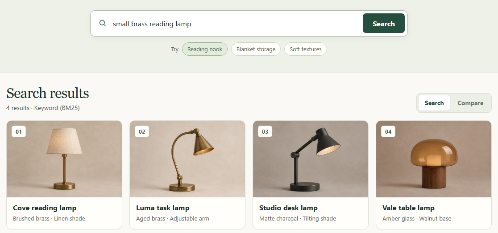

# Adaptive Retrieval Core

**一个检索 API，支持关键词、向量、混合与重排检索。** 查看同一条查询在不同策略下的排序。

[启动演示](docs/QUICKSTART.md#start-with-uv) · [快速启动](docs/QUICKSTART.md) · [文档](docs/INDEX.md) · [English](README.md)

*截图展示内置 22 件虚构商品目录的实时 BM25 结果。商品图片为生成素材，CPU Demo 使用随包提供的素材。* [查看实时策略对比](docs/assets/showcase-v2/compare.png)

## 可以查看什么

- 通过 Playground、CLI 或 FastAPI 查询同一语料。结果保留源 ID 和名次。
- 配置 BGE 和兼容的 FAISS 索引即可使用 Dense 和 Hybrid，加入 MiniLM 可启用重排。用同一查询比较两种可用策略，按需展开检索诊断。

## V0 正式实验

**SciFact** 的 Dense 取得最高观测 NDCG@10（0.712707）。**WANDS** 的 Hybrid + Rerank 最高，为 0.744195，Hybrid 为 0.726482。在 WANDS 上加入重排后，串行环回 HTTP p95 从 68.89 ms 增至 416.11 ms。

WANDS 使用 ARC 自定义 80/400 拆分与不完整标注。时延来自搭载 RTX 4060 的 Windows 11 笔记本。V0 面向本地使用和评测，生产级访问控制、租户隔离和并发容量超出其验收范围。[完整结果与测量条件](docs/ARC-V0-ACCEPTANCE.md)

[工程设计](docs/ENGINEERING.md) · [复现实验](docs/REPRODUCING.md) · [演示语料与素材来源](docs/SHOWCASE.md) · [v0.1.0 发布](https://github.com/re-tourist/adaptive-retrieval-core/releases/tag/v0.1.0)
