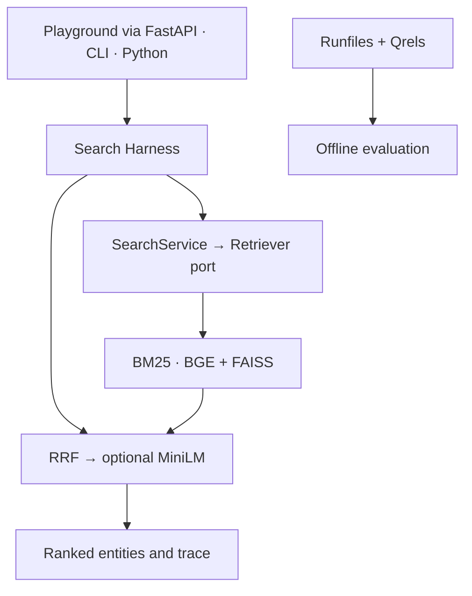

# How ARC runs a search

The CLI and HTTP API adapt inputs to the same Search Harness. The Playground is a small, same-origin client of `POST /search`. Its configuration supplies the active corpus, the snapshot IDs advertised by `GET /healthz`, and, for the bundled catalog, presentation metadata keyed by stable product ID.

## Search and score semantics

| Strategy | Work per query | Public score |
| --- | --- | --- |
| E1 · BM25 | Match tokenized query terms with length-normalized term statistics | BM25 |
| E2 · Dense | Encode with BGE and search normalized vectors in a FAISS flat index | Cosine similarity |
| E3 · Hybrid | Fuse the sparse and dense rankings with RRF, k=60 | RRF |
| E4 · Hybrid + Rerank | Rescore the first 50 E3 candidates with MiniLM and keep the tail | Rank encoding |

Scores are meaningful within a strategy. Compare result order across strategies. The summary trace reports stages, elapsed time, and counts. It excludes query text, relevance labels, and cross-encoder logits. The catalog enables a positive-score policy for BM25 so unmatched items do not fill empty ranks. Other corpora use the V0 behavior, which can return zero-score entries at larger depths.

## Data and dependency boundaries

- The domain models source entities separately from the units the retrievers rank. The application owns the search use case and Ports. Concrete retrievers and corpus loaders are adapters wired at bootstrap.
- Snapshot compatibility binds the dense index to corpus content, encoder revision, and ordered source IDs. A request can name a snapshot to reject accidental use of a different one. Only load trusted local index artifacts.
- Online SciFact and WANDS loaders read corpus content. Qrels, test partitions, metrics, and runfiles belong to offline evaluation. The Playground calls the same retrieval path and the optional field notes have their own corpus fingerprint.
- The V0 service runs the harness serially within one process. MiniLM adds work proportional to the reranked prefix. See [the measured results](ARC-V0-ACCEPTANCE.md#性能与成本) for the local timing protocol and evidence.
- When a BGE model is supplied without an index in catalog mode, ARC builds its small FAISS snapshot in memory. Corpus content fingerprints bind both adapters to the same text. Browser rank movement is derived from the two live responses by source ID.

[Start ARC](QUICKSTART.md) · [Frozen architecture specification](architecture/ARC-TECH-001.md) · [Evaluation protocol](evaluation/ARC-EXP-001-EXECUTION-DECISION.md)
